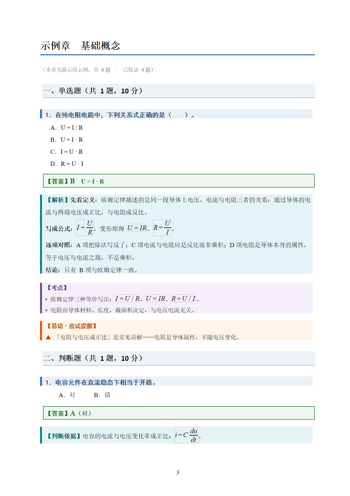

# dsh-exam-revision

把**复习题截图**变成一份排版好的 **Word 详解册**。

装好之后，你只要把题目图片发给 DSH，说一句"整理成复习资料"，就会得到：

- 逐题的**答案**（绿色框，不是批改红）
- 分步**解析**（青色块，每步写清依据）
- **考点**（紫色块）与**易错提醒**（橙色块）
- 封面、目录、页脚页码
- 文末**答案速查表**（选择题 5 组一行，简答挂一句话结论）



> 上图由 `examples/demo.json` 渲染而来，示例题目只用于展示排版。

## 它由两部分组成

| 部分 | 作用 | 没有它也能用吗 |
|---|---|---|
| **技能** `exam-revision` | 告诉 agent 怎么读图、怎么解题、怎么建题库、怎么交付 | 核心，必须有 |
| **工具** `exam_docx` | 一条调用把题库 JSON 渲染成 docx | 可以用技能内置的 python 脚本代替 |

技能安装后是**自包含**的：`assets/` 里带着渲染脚本，工具不可用时可直连 python 跑，产出完全一致。

## 安装

```powershell
# 1) 技能（直接复制即可，DSH 下次启动就会列进技能目录）
Copy-Item ".\skills\exam-revision" "$env:USERPROFILE\.dsh\skills\" -Recurse -Force

# 2) 插件（注册工具，需要重启 DSH 生效）
#    在 DSH 设置 → 插件里选择"从本地安装"，指向本目录；
#    或让 agent 调 plugin_manager，target 传 file:<本目录绝对路径>
```

首次安装插件后**必须重启 DSH**：profile 的 bundles 列表只在 boot 时读取。

## 用法

直接发图，说"整理成复习资料"即可。agent 会：

1. 逐张读完图片，抄录题号/题干/选项/公式
2. 逐题解题，写解析、考点、易错
3. 建 `题库.json`（唯一数据源）
4. 调 `exam_docx(questions="…\\题库.json", out="…\\继电保护复习题详解.docx")`
5. `present` 文档 + 给答案速览

**后续加章节**：把新图发过去，agent 读现有 `题库.json`、追加、重渲染——还是同一份 Word，不会另起一个文件。

## 目录结构

```
exam-revision-plugin/
├─ package.json            # dsh.bundle.patch 指向补丁层
├─ cordis.patch.yml        # 把宿主半挂成 cordis 插件
├─ lib/host.js             # 注册 exam_docx 工具 + 自动安装技能
├─ skills/exam-revision/
│  ├─ SKILL.md             # 完整工作流与写作规范
│  └─ assets/
│     ├─ build_docx.py     # 题库 JSON → Word（五色分区）
│     └─ omml_helper.py    # $...$ → Word 原生公式
└─ test/smoke.mjs          # 不依赖宿主，直接跑通渲染链路
```

## 自测（不需要 DSH）

```powershell
node test\smoke.mjs examples\demo.json out.docx
```

仓库里的 `examples/demo.json` 是 4 道示例题（单选 / 判断 / 填空 / 简答各一），
用来快速验证渲染链路，也是题库格式的活文档。

## 题库 JSON 结构

```json
{
  "cover": {"text1": "继电保护", "text2": "复 习 题 详 解"},
  "chapters": [{
    "title": "第一章　概述",
    "meta": "本章共 100 题、满分 100 分",
    "sections": [{
      "title": "一、单选题（共 40 题，40 分）",
      "questions": [{
        "id": 1, "kind": "single",
        "stem": "远后备保护通常安装在（　　）。",
        "options": {"A": "…", "B": "…", "C": "…", "D": "…"},
        "answer": "D",
        "steps": ["**抓住定义**：…"],
        "points": ["…"], "traps": ["…"]
      }]
    }]
  }]
}
```

`kind` 取 `single` / `multi` / `judge` / `blank` / `short`。
判断题 `options` 固定 `{"A": "对", "B": "错"}`，`answer` 用 `"A"`/`"B"`。
`short`（简答）与 `blank`（填空）不给 `options`。

## 已知坑

- **Word 打开大文档很慢**（100 页以上要十几秒，还要更新目录域）。不要因为"没反应"就杀进程，
  强杀会让 Word 进安全模式，甚至把文件拉进 `Resiliency\DisabledItems` 黑名单。
- 插件以**副本**形式装进 profile：改了本目录的代码，要重新安装一次才生效。
- 技能是自包含的，改 `assets/build_docx.py` 后重新复制技能目录即可。
